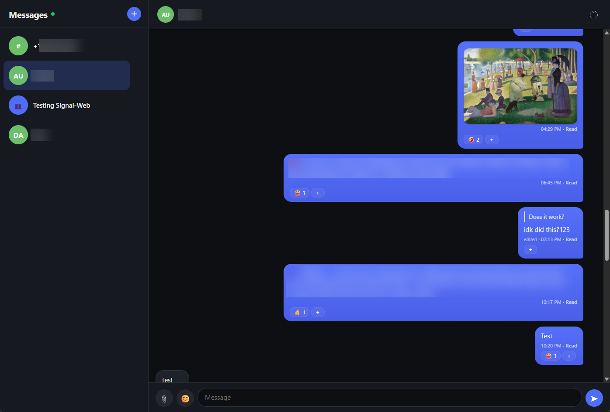

# Signal Web

**A self-hosted Signal client for the browser.** Link it to your Signal account
as a secondary device and read or send messages from any web browser — your
messages stay on infrastructure you control, encrypted at rest.

[](./LICENSE)


> ⚠️ **This is unofficial, community-built software.** It is not affiliated with,
> endorsed by, or maintained by the Signal Foundation. Signal is a trademark of the
> Signal Foundation. Use at your own risk — see
> [Disclaimer & Security](#disclaimer--security) below.



## Why

Signal doesn't ship an official web client. If you've wanted Signal on your
laptop or a spare tablet without installing the official desktop app, or you
simply prefer a browser-based UI you host yourself, this gives you one. It runs
on a $6/month VM, links to your existing Signal account, and is built for one
user: **you** (or whoever you set it up for).

- 🔒 **End-to-end encrypted** by Signal's protocol (between your phone and contacts)
- 🗄️ **Encrypted at rest** — messages live in a SQLCipher DB on your host
- 🌐 **Web-based** — works in any modern browser, including on mobile
- 🧩 **Self-hosted** — no third party sees your traffic or stores your data

## Features

**Messaging**
- Send and receive text, images, and file attachments (paste or drag-drop images into the composer)
- Clickable links and search across every conversation
- Honors Signal disappearing-message timers; history window is configurable
- Quote-reply, edit, and delete messages
- Emoji picker, message reactions, typing indicators
- Live updates over WebSocket (no refresh needed)
- Read receipts with graduated status (**Sent → Delivered → Read**)
- Group support: member list, sender labels, group rename
- Start new conversations by phone number
- Desktop notifications with sender + preview

**UX**
- Warm light/dark theme (auto-follows OS preference)
- Responsive layout — works on phone, tablet, desktop
- Image lightbox, conversation list with unread badges
- Connection-status indicator, toast error feedback, error boundary

**Security**
- SQLCipher-encrypted message store; the key never leaves your host
- Password auth (Argon2id), optional WebAuthn/passkey 2FA (add a key under Settings)
- Log out, or log out every device at once
- CSRF protection, secure cookies, per-IP login rate limiting
- Content-Security-Policy, HSTS, and hardening headers on every response
- Runs as a non-root container user; signal-cli image digest-pinned
- No third-party analytics, scripts, or trackers
- Attachment blobs AES-256-GCM encrypted on disk

## How it works

```
┌────────────┐     HTTPS      ┌─────────────────┐     json-rpc      ┌─────────────────────────┐
│  Browser   │ ─────────────▶ │   signal-web    │ ────────────────▶ │   signal-cli-rest-api   │
│ (React SPA)│ ◀──WebSocket── │  (Fastify app)  │ ◀────messages──── │   (bbernhard image)     │
└────────────┘                └─────────────────┘                   └────────────┬────────────┘
                                     │                                            │
                                     │  SQLCipher DB + encrypted blobs            │  Signal servers
                                     ▼                                            ▼
                              ./data/signal-web.db                              (E2E with phone)
```

The app links to your Signal account as a **secondary device** (like Signal
Desktop). `signal-cli` bridges between Signal's protocol and a REST/WS API the
app consumes. Your phone stays the primary device; the linked device receives
messages **from the moment of linking forward** (no history backfill).

## Quick start (local)

**Prerequisites:** Docker + Docker Compose, a phone with Signal installed.

### 1. Clone and configure

```bash
git clone https://github.com/austingregoryus/signal-web.git
cd signal-web
cp .env.example .env
```

Edit `.env` and fill in:

```bash
SIGNAL_NUMBER=+15551234567
DB_KEY=<run: node -e "console.log(require('crypto').randomBytes(32).toString('base64'))">
PUBLIC_URL=http://localhost:8190
ENABLE_LINK_PAGE=true
LINK_BOOTSTRAP_TOKEN=<run: openssl rand -base64 24, and paste the result>
```

`PUBLIC_URL` must match the address in your browser's URL bar — the live
WebSocket rejects any other origin, and messages then stop updating live.
`localhost` counts as secure, so the default `SECURE_COOKIES=true` works there;
if you instead open it from another machine over plain `http://<LAN-IP>:8190`,
set both `PUBLIC_URL` to that address and `SECURE_COOKIES=false`, or login
cookies are silently dropped.

> **Keep `DB_KEY` stable and back it up.** It's the only thing that can decrypt
> your message store; losing it loses all messages.

### 2. Link your device (one-time)

signal-cli needs `normal` mode to generate a linking QR, so use the linking
override compose:

```bash
docker compose -f docker-compose.yml -f docker-compose.link.yml up -d --build
```

Wait ~60–90s for signal-cli to boot, then check the logs:

```bash
docker compose logs app
```

You'll see a `[link]` line pointing to a URL like
`http://localhost:8190/link?t=<LINK_BOOTSTRAP_TOKEN>`. Open that URL in a
browser and scan the QR from
**Signal → Settings → Linked Devices → Link New Device**.

Watch the logs for `[signal] connected to signal-cli` to confirm the link.

> The `[signal] receiver error: 400` lines during this phase are expected —
> json-rpc doesn't work in `normal` mode. They stop once you switch to the
> normal stack.

### 3. Set a password

```bash
docker compose -f docker-compose.yml -f docker-compose.link.yml exec \
  -e NEW_PASSWORD='a-strong-password' app npm run set-password
```

### 4. Switch to the normal stack

```bash
docker compose -f docker-compose.yml -f docker-compose.link.yml down
```

Edit `.env`: set `ENABLE_LINK_PAGE=false`. Then:

```bash
docker compose up -d --build
```

Open `http://localhost:8190`, log in with your password, done. ✅

### Local UI development

For hot-reload frontend work, run the Vite dev server in parallel:

```bash
npm --prefix web install   # one-time
npm --prefix web run dev   # http://localhost:5173 (proxies API to :8190)
```

## Deploying to the internet

The app binds to `127.0.0.1` only — public access is via a Cloudflare Tunnel (or
any reverse proxy that terminates HTTPS).

**👉 See [`DEPLOY.md`](./DEPLOY.md)** for the full runbook:

- VM provisioning (2 GB Ubuntu)
- `.env` production values (`PUBLIC_URL`, `SECURE_COOKIES=true`, `RP_ID`, …)
- Cloudflare Tunnel setup (token-based or config-based)
- Verification checklist + troubleshooting

**Backup & recovery:** [`docs/ops/BACKUP.md`](./docs/ops/BACKUP.md) covers what
to back up (encrypted DB, `DB_KEY`, device keys), a restic sample, and the
key-loss / compromise recovery paths.

## Configuration

All config is via environment variables (`.env`). See
[`.env.example`](./.env.example) for the full list with comments. The essentials:

| Variable | Required | Description |
|---|---|---|
| `SIGNAL_NUMBER` | yes | Your Signal phone number (E.164, e.g. `+15551234567`) |
| `DB_KEY` | yes | SQLCipher encryption key — **keep it stable**, losing it loses all messages |
| `PUBLIC_URL` | prod | The public HTTPS origin (e.g. `https://signal.example.com`) |
| `ALLOWED_ORIGIN` | prod | Comma-separated origins allowed to open the live WebSocket |
| `SECURE_COOKIES` | prod | `true` behind HTTPS so session cookies carry the `Secure` flag |
| `RP_ID` | prod | The registrable domain (for WebAuthn/passkeys) |
| `ENABLE_LINK_PAGE` | link | `true` only during device linking; `false` in production |
| `LINK_BOOTSTRAP_TOKEN` | link | A random token you choose to gate `/link` before the password is set |
| `MESSAGE_RETENTION_DAYS` | no | Delete messages older than this many days (default `14`; `0` keeps them forever). Disappearing-message timers set in Signal still apply, once the app has seen a message or timer change in that chat (see [DEPLOY.md](DEPLOY.md) troubleshooting). |

## Development

**Stack:** Fastify 5, better-sqlite3-multiple-ciphers (SQLCipher), React 19 + Vite,
signal-cli-rest-api. TypeScript throughout, no framework magic.

```bash
npm install              # backend deps
npm --prefix web install # frontend deps

npm test                 # backend tests (205)
npm --prefix web test    # frontend tests (59)
npm run typecheck        # backend tsc
npm --prefix web run typecheck
npm run dev              # backend with watch (tsx)
npm --prefix web run dev # frontend Vite dev server
```

### Project layout

```
src/
  app/           composition root, security headers, link bootstrap
  api/           Fastify routes (REST, WebSocket, attachments, static, linking)
  auth/          password (Argon2id), sessions, CSRF, WebAuthn, rate limiting
  signal/        signal-cli client, envelope parser, ingest, live bridge
  store/         SQLite repos (messages, conversations, attachments, …) + migrations
  profile/       contact/group name sync
web/
  src/           React SPA (components, hooks, API client)
docs/
  ops/BACKUP.md  backup & recovery runbook
DEPLOY.md        deployment runbook (Cloudflare Tunnel)
```

## Disclaimer & Security

### What this is — and isn't

This is **unofficial, hobbyist software**. It is:

- ✅ A way to read and send your Signal messages from a browser you host.
- ✅ Encrypted at rest and in transit (where stated).
- ❌ **Not** audited, hardened to enterprise standards, or guaranteed secure.
- ❌ **Not** affiliated with, endorsed by, or supported by the Signal Foundation.

If your threat model includes a sophisticated adversary, a compliance
requirement, or any situation where a bug could cause real harm, **do not use
this**. Use the official Signal apps, which are professionally audited.

### Security model

- **At rest:** the SQLite store is SQLCipher-encrypted with `DB_KEY`; attachment
  blobs are AES-256-GCM encrypted on disk. `DB_KEY` is the single most sensitive
  secret — back it up separately (see [`BACKUP.md`](./docs/ops/BACKUP.md)).
- **In transit:** the app expects to sit behind HTTPS. Cookies are `Secure` +
  `HttpOnly` + `SameSite=Strict`. CSRF is double-submit cookie + header.
- **Auth:** password (Argon2id) gates a session; optional WebAuthn steps it up.
  Login attempts are per-IP rate-limited with a global backstop.
- **Trust boundary:** the app trusts signal-cli (same Docker network) and the
  reverse proxy (`TRUST_PROXY` defaults to trusting only loopback/private-network
  peers such as the cloudflared sidecar, so the real client IP is resolved
  without letting clients spoof `X-Forwarded-For` — **never expose the app port
  directly**). Everything else is untrusted.

### What this does NOT protect against

- An attacker who gets your `DB_KEY` **and** the DB file can read everything.
- An attacker who compromises your linked device's Signal keys can read live
  traffic and send messages as you.
- A bug in this software could expose messages, lock you out, or worse.

Treat any of those as a full Signal-account compromise: revoke the linked device
from your phone (**Settings → Linked Devices → Revoke**) and re-link from scratch.

### Reporting a security issue

This is a personal project without a formal security program. If you find
something, please open a private GitHub Security Advisory or email the
maintainer directly — **do not open a public issue** for security bugs. There's
no SLA; this is best-effort.

## Limitations

- A linked device receives messages **from the moment of linking forward** — no
  history backfill from Signal's servers.
- **Single-user by design** — there's no multi-account or user management.
- Voice notes, video, and stickers are not supported (text + images + files).
- Text formatting (bold/italic/etc.) from other clients isn't rendered.

## FAQ

**Can I run multiple Signal numbers?**
No — this is built for one user/number. Run multiple instances (separate VMs or
compose project names) if you need that.

**Does this weaken Signal's encryption?**
No. Signal's end-to-end encryption still applies between your phone and your
contacts. This app sits alongside your phone as a linked device, exactly like
Signal Desktop — the protocol is unchanged.

**Why does it need a password if Signal is already encrypted?**
The password gates **access to the web app** (the browser UI), not Signal's
E2E protocol. It prevents someone who can reach your URL from reading your
messages. Add a WebAuthn passkey for second-factor protection.

**What happens if Signal changes their protocol?**
The underlying `signal-cli` would need an update. Watch the
[bbernhard/signal-cli-rest-api](https://github.com/bbernhard/signal-cli-rest-api)
project for new versions; bump the image in `docker-compose.yml` (re-pulling the
new digest) and rebuild.

## Credits

Built on [signal-cli](https://github.com/AsamK/signal-cli) and the
[signal-cli-rest-api](https://github.com/bbernhard/signal-cli-rest-api) Docker
image by [bbernhard](https://github.com/bbernhard). Signal is a trademark of the
Signal Foundation; this project is independent and not affiliated.

## License

[MIT](./LICENSE) © Austin Gregory
